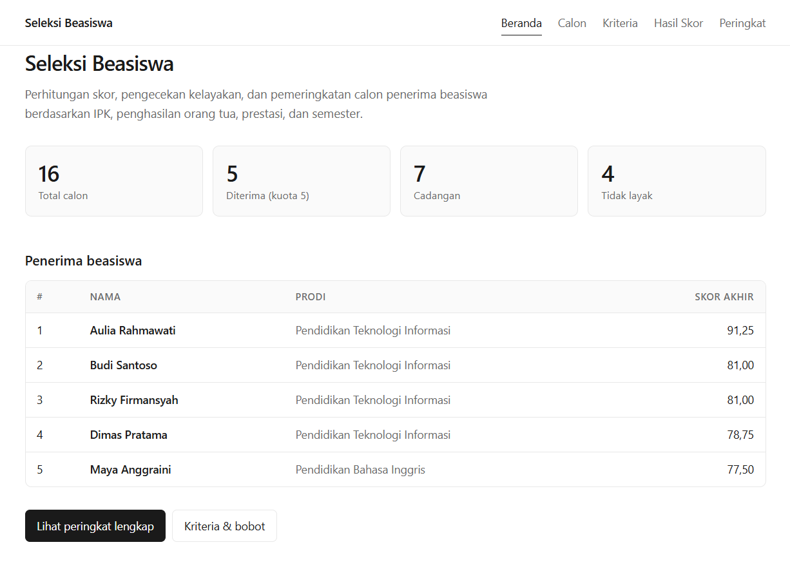
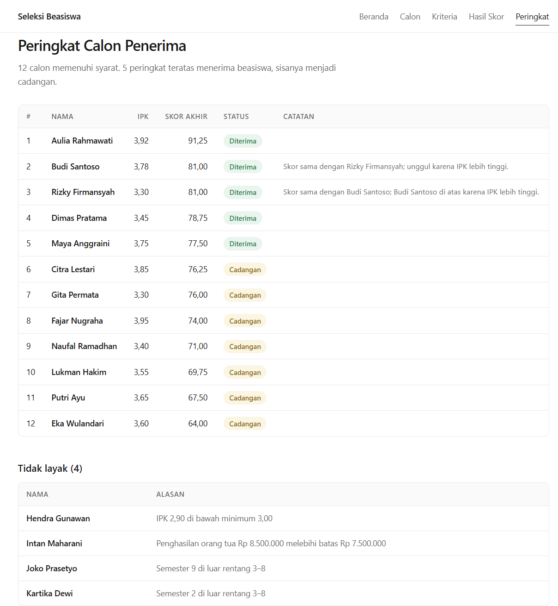
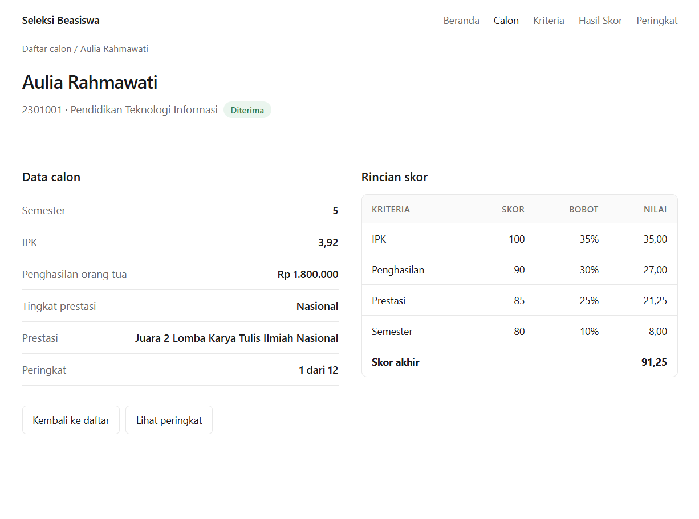
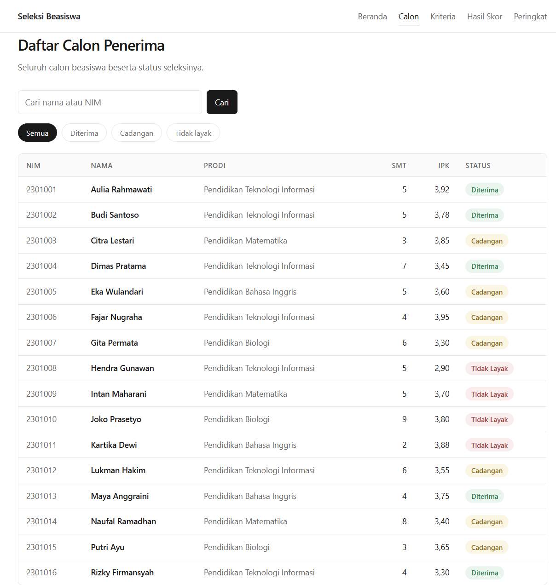
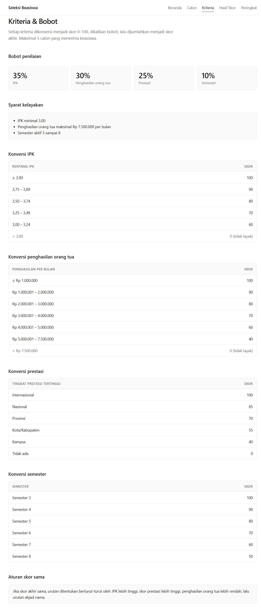
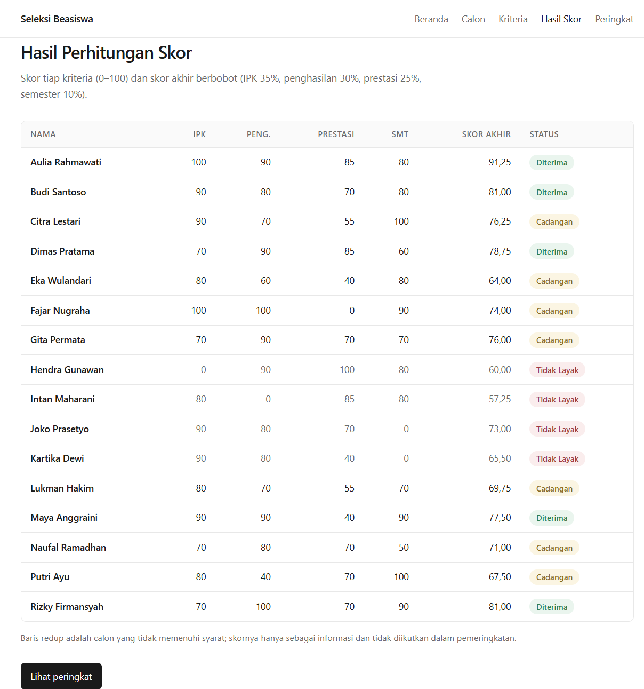

# Sistem Seleksi dan Pemeringkatan Beasiswa

UTS Pemrograman Internet · Program Studi Pendidikan Teknologi Informasi · FKIP Universitas Muhammadiyah Tasikmalaya

## Identitas

| | |
|---|---|
| Nama lengkap | Muhamad Rizal Rivardi |
| NIM | C2483207007 |
| Kelas | PTI5A |
| Tema | Tema 2 — Sistem Seleksi dan Pemeringkatan Beasiswa |

## Deskripsi Permasalahan dan Solusi

Sebuah perguruan tinggi memiliki program beasiswa dengan jumlah penerima terbatas.
Penilaian manual berisiko menimbulkan kesalahan hitung dan hasil yang tidak konsisten.

Aplikasi ini menghitung skor setiap calon berdasarkan empat kriteria berbobot, memeriksa
kelayakan, mengurutkan calon yang layak, dan menetapkan maksimal **5 penerima**. Calon yang
tidak layak ditampilkan beserta alasannya, dan skor yang sama ditangani dengan aturan
tie-break yang jelas.

Data berupa **array PHP** (16 calon) di `app/Models/CalonPenerima.php`. Tidak ada database
dan tidak ada autentikasi.

## Implementasi Routing, Controller, dan Blade View

### Routing (`routes/web.php`)

| URL | Controller@method | Keterangan |
|---|---|---|
| `/` | `HomeController@index` | Halaman utama dan ringkasan |
| `/mahasiswa` | `MahasiswaController@index` | Daftar calon (+ pencarian `?cari=`) |
| `/mahasiswa/{id}` | `MahasiswaController@show` | Detail calon (parameter URL `id`) |
| `/status/{status}` | `MahasiswaController@byStatus` | Penyaringan: `diterima`, `cadangan`, `tidak-layak` |
| `/kriteria` | `KriteriaController@index` | Kriteria, bobot, dan aturan konversi |
| `/hasil-skor` | `SeleksiController@hasil` | Hasil perhitungan skor semua calon |
| `/peringkat` | `SeleksiController@peringkat` | Pemeringkatan dan daftar tidak layak |

Parameter `{id}` dibatasi angka (`whereNumber`) dan `{status}` dibatasi tiga nilai valid.
ID yang tidak ada menghasilkan halaman 404.

### Controller (`app/Http/Controllers`)

- `HomeController`, `MahasiswaController`, `KriteriaController`, `SeleksiController`.
- Seluruh perhitungan berada di Controller lewat trait `Concerns/HitungSeleksi.php`
  (konversi skor, kelayakan, pengurutan, status). View hanya menampilkan hasil.

### Model (`app/Models/CalonPenerima.php`)

Kelas biasa (bukan Eloquent) yang menyediakan data calon dalam bentuk array.

### Blade View (`resources/views`)

- `layouts/app.blade.php` — layout utama (`@yield`) dan navigasi.
- Halaman memakai `@extends` dan `@section`: `beranda`, `mahasiswa/index`, `mahasiswa/show`,
  `mahasiswa/status`, `kriteria`, `hasil`, `peringkat`.
- `partials/badge.blade.php` — label status (`@include`).
- Memakai `@foreach`, `@if`/`@elseif`/`@else`, `@unless`, dan `$loop`.
- Tampilan minimalis dengan CSS sendiri di `public/css/style.css` (tanpa Bootstrap, tanpa build).

## Logika Perhitungan

### 1. Syarat kelayakan

Calon layak jika **semuanya** terpenuhi:

- IPK ≥ 3,00
- Penghasilan orang tua ≤ Rp 7.500.000 per bulan
- Semester 3 sampai 8

Jika tidak, calon dikeluarkan dari pemeringkatan dan alasannya ditampilkan.

### 2. Bobot dan konversi skor 0–100

| Kriteria | Bobot |
|---|---|
| IPK | 35% |
| Penghasilan orang tua | 30% |
| Prestasi | 25% |
| Semester | 10% |

**IPK**: ≥ 3,90 → 100 · 3,75–3,89 → 90 · 3,50–3,74 → 80 · 3,25–3,49 → 70 · 3,00–3,24 → 60

**Penghasilan** (makin rendah makin tinggi skornya): ≤ 1 jt → 100 · ≤ 2 jt → 90 · ≤ 3 jt → 80 ·
≤ 4 jt → 70 · ≤ 5 jt → 60 · ≤ 7,5 jt → 40

**Prestasi** (tingkat tertinggi): Internasional 100 · Nasional 85 · Provinsi 70 ·
Kota/Kabupaten 55 · Kampus 40 · Tidak ada 0

**Semester**: 3 → 100 · 4 → 90 · 5 → 80 · 6 → 70 · 7 → 60 · 8 → 50

### 3. Skor akhir

```
Skor akhir = (skor IPK × 35 + skor penghasilan × 30 + skor prestasi × 25 + skor semester × 10) / 100
```

Perbandingan skor memakai bilangan bulat (`total_poin`) agar pengecekan skor sama tidak
terganggu pembulatan desimal.

### 4. Contoh perhitungan (Aulia Rahmawati)

| Kriteria | Data | Skor | Bobot | Nilai |
|---|---|---|---|---|
| IPK | 3,92 | 100 | 35% | 35,00 |
| Penghasilan | Rp 1.800.000 | 90 | 30% | 27,00 |
| Prestasi | Nasional | 85 | 25% | 21,25 |
| Semester | 5 | 80 | 10% | 8,00 |
| **Skor akhir** | | | | **91,25** |

### 5. Pemeringkatan, kuota, dan skor sama

1. Calon layak diurutkan dari skor akhir tertinggi.
2. Jika skor akhir sama, urutan ditentukan berturut-turut oleh: **IPK lebih tinggi →
   skor prestasi lebih tinggi → penghasilan lebih rendah → abjad nama**.
3. Lima peringkat teratas berstatus **Diterima**, sisanya **Cadangan**.
4. Catatan tie-break ditampilkan di halaman Peringkat dan Detail. Contoh pada data:
   Budi Santoso dan Rizky Firmansyah sama-sama 81,00; Budi unggul karena IPK lebih tinggi.
   Jika skor sama jatuh tepat di batas kuota (peringkat 5 dan 6), muncul peringatan khusus.

## Screenshot
## Tampilan Beranda


## Tampilan Peringkat Calon Penerima


## Tampilan Detail Calon


## Tampilan Daftar Calon Penerima


## Tampilan Kriteria & Bobot


## Tampilan Hasil Perhitungan Skor


## Petunjuk Menjalankan

Prasyarat: PHP 8.3+ dan Composer.

```bash
git clone <url-repository>
cd beasiswa-laravel

composer install
cp .env.example .env        # Windows: copy .env.example .env
php artisan key:generate
php artisan serve
```

Buka <http://127.0.0.1:8000>.

Aplikasi tidak memerlukan database (session dan cache memakai file) maupun `npm`.

## Struktur Folder Utama

```
app/
  Http/Controllers/
    Concerns/HitungSeleksi.php   # logika perhitungan
    HomeController.php
    MahasiswaController.php
    KriteriaController.php
    SeleksiController.php
  Models/CalonPenerima.php       # data array
resources/views/
  layouts/app.blade.php
  partials/badge.blade.php
  beranda.blade.php  kriteria.blade.php  hasil.blade.php  peringkat.blade.php
  mahasiswa/ (index, show, status)
routes/web.php
public/css/style.css
screenshots/
```
